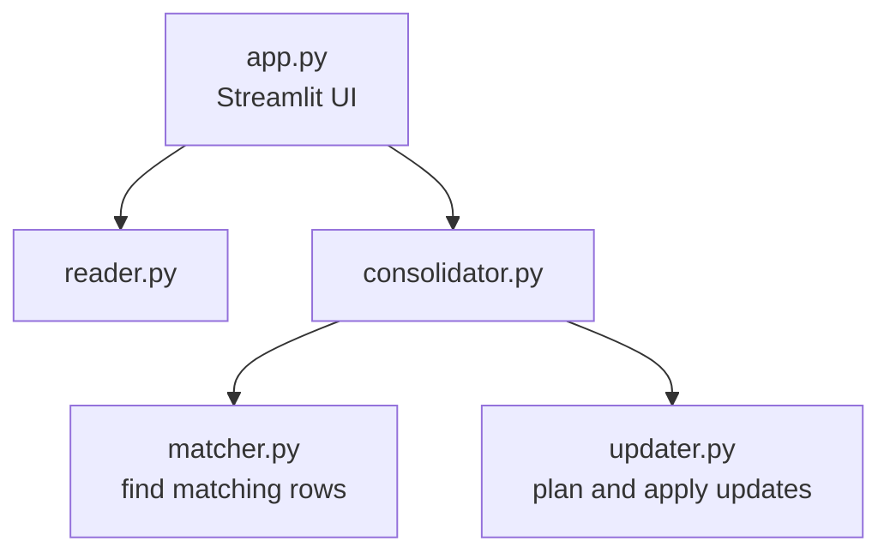

<div align="center">

# SheetSync

**Copy columns from one Excel file into another, matched by the rows they share.**

No formulas. No lookups. Pick the columns, check the preview, download the result.

<p>
  
  
  
  
</p>

[Quick start](#quick-start) · [How it works](#how-it-works) · [Safety](#built-to-be-safe) · [The report](#the-matching-report) · [For developers](#for-developers) · [Limitations](#limitations)

</div>

---

## Why SheetSync

You have one spreadsheet with the numbers you need and another that needs them filled in. Doing it by hand means copy and paste, or a `VLOOKUP` that breaks the moment a name has a stray space. SheetSync does the matching for you, shows you exactly what will change, and hands back an updated copy of your workbook.

Say you have these two files:

| **Source**: `District_Data.xlsx** | | | | **Destination**: `District_Master.xlsx` | | |
|:--|--:|--:|:-:|:--|--:|--:|
| **District** | **Population** | **Literacy** | | **District** | **Total Population** | **Literacy Rate** |
| Kolar | 650000 | 82% | | Kolar | | |
| Mysuru | 350000 | 85% | | Mysuru | | |
| | | | | Hassan | | |

You tell SheetSync three things:

- match **District** with **District**
- copy **Population** into **Total Population**
- copy **Literacy** into **Literacy Rate**

You get back your workbook with Kolar and Mysuru filled in. Hassan isn't in the source, so it is left alone and listed as not matched.

## The five steps


1. **Upload the source file.** Excel or CSV. SheetSync reads it straight away and shows the columns it found.
2. **Upload the destination workbook.** The Excel file you want to update. Its columns are shown too.
3. **Select columns.** Choose which columns identify the same row in both files, then which columns to copy and where they go. Add as many columns as you like with **+ Add another column**.
4. **Preview.** Three numbers tell you the story: *Records matched*, *Cells to update* and *Records not matched*. Open **Show details** only if you want to see every change.
5. **Download.** One button gives you the updated workbook.

Each step appears only after the one before it is done, so there is never more on screen than you need.

## Quick start

```bash
git clone https://github.com/Aryamann687/SheetSync.git
cd SheetSync

python -m venv .venv
source .venv/bin/activate          # Windows: .venv\Scripts\activate

pip install -r requirements.txt
streamlit run app.py
```

Streamlit opens the app in your browser. Everything runs on your own machine, and your spreadsheets are never uploaded to a server.

The repository includes sample files you can use to try it out.

## How it works

SheetSync looks at each row in your **destination** workbook and tries to find the same row in the **source** file, using the columns you chose to match on. It tries three things, in order:

| | What it catches | Example | Copied automatically? |
|---|---|---|:-:|
| **Exact** | Identical values | `EMP001` and `EMP001` | Yes |
| **Ignoring formatting** | Capitals, extra spaces, punctuation, and numbers stored as `1001` or `1001.0` | `" kolar "` and `Kolar` | Yes |
| **Looks similar** | Small spelling differences | `Chikkamagaluru` and `Chikkamagalur` | Only after you tick it |

Rows that only *look* similar are never copied on their own. They appear in a short list (**"1 row looks similar. Check it."**) and nothing is copied for a row until you tick **Same row**. Very short values and plain numbers are never guessed at, and if two candidates look almost equally likely, SheetSync makes no suggestion at all.

### More options

Under **More options** (closed by default):

- **Replace values that are already in the destination.** By default SheetSync only fills empty cells and never touches a value that is already there.
- **Only match rows that are exactly the same.** Switches off the formatting and similar-row steps, so only identical values are matched. Handy for IDs, where `EMP005` and `EMP006` must never be confused.

### More than one matching column

Need two columns to identify a row, such as first name and last name? Use **+ Add another matching column**. A row only matches when every matching column agrees.

## Built to be safe

SheetSync is designed so that the worst case is "nothing happened", never "my data got damaged".

- **Your original file is never changed.** You always download an updated copy.
- **Formulas are never overwritten**, even if you choose to replace existing values.
- **Blank source cells are never copied**, so they can't erase anything.
- **Merged cells are skipped** rather than risked.
- **Duplicates are left alone.** If the same ID appears twice in the source, SheetSync can't know which one you mean, so it copies neither and tells you why.
- **Similar-looking rows need your tick** before anything is copied.
- **You can't copy into the column you match on**, which would change the very thing that finds each row.
- **You see a preview first.** Nothing is saved until you download.

## The matching report

Next to the workbook you can download a CSV listing every row in the destination file and what happened to it:

| Column | Meaning |
|---|---|
| Row in destination file | The Excel row number |
| Record in destination file | The value(s) used to match |
| Result | Matched, Needs review, Not found, Duplicate, Invalid information or Unclear |
| Details | A plain-language reason, such as "Exact match" or "Duplicate in source file" |
| Row in source file | The row it was matched with (or suggested for) |
| Record in source file | The matching value in the source |
| Similarity (0-100) | How alike the two values are, for suggested rows |
| Your decision | Confirmed, Not confirmed, or Not needed |

It's a handy audit trail, and a quick way to spot typos that stopped a row from matching.

## Limitations

SheetSync is a focused tool, and it's honest about what it doesn't do:

- **Embedded objects may not carry over.** Cell values, formatting and formulas are kept as far as the Excel library allows, but charts, images and similar objects in the destination may not survive. Open the result in Excel and check.
- **Destination files must be `.xlsx`.** The source can be `.xlsx` or `.csv`.
- **IDs stored as numbers.** If an ID column is numeric and one file has a blank cell, Excel data can be read as `1001.0` in one file and `1001` in the other. The default matching handles this. *Exactly the same* does not, so store IDs as text if you use that option.
- **One source file at a time in the app.** The engine underneath can combine several (see below), but the interface keeps things simple.
- **Very large files** take longer, because matching similar rows compares each unmatched row against the source.

## For developers

### Project structure

```text
SheetSync/
├── app.py                  # Streamlit interface (the five steps)
├── core/
│   ├── reader.py           # Loads Excel/CSV: sheets, header row, column names
│   ├── matcher.py          # Exact, formatting-insensitive and similar-row matching
│   ├── updater.py          # Builds and applies cell updates (formula and merged-cell safe)
│   └── consolidator.py     # Per-source matching plus one merged, conflict-checked update
├── tests/                  # pytest suite: backend logic and UI scenarios
├── .streamlit/config.toml  # Theme
├── requirements.txt
└── sample.xlsx, sample.csv, header_test.xlsx
```

### Architecture

The interface contains no matching or update logic of its own. Everything goes through the consolidation layer, which wraps the tested core modules.



| Module | Responsibility |
|---|---|
| `reader.py` | Reads a sheet into a table, validates column names, and records each row's Excel row number |
| `matcher.py` | `run_match(...)` returns a status for every destination row. Supports `mode="recommended"` and `mode="strict"` |
| `updater.py` | `build_plan(...)` previews the exact cell updates and skips; `apply_plan(...)` writes them to a copy of the workbook |
| `consolidator.py` | Matches each source with its own settings, merges all sources' updates into one plan, detects conflicts, and applies the result **once** |

### The consolidation engine

The engine supports any number of source files feeding one destination. Every source is matched against the destination **as uploaded**, never against another source's changes, so results don't depend on order. If two sources propose different values for the same cell, that cell is blocked and reported. There is no silent last-write-wins.

```python
import io
from core.reader import load_table
from core.consolidator import (
    MatchSettings, SourceEntry, SourceSpec, apply_consolidated, build_source_plan,
    consolidate, make_destination, match_source,
)

def load(path, sheet="Sheet1"):
    f = io.BytesIO(open(path, "rb").read())
    f.name = path
    return load_table(f, sheet=sheet)

dest_bytes = open("District_Master.xlsx", "rb").read()
dest = make_destination(dest_bytes, "Sheet1", 1, load("District_Master.xlsx"))

entries = []
for sid, path, column in [("a", "Population.xlsx", "Population"), ("b", "Literacy.xlsx", "Literacy")]:
    spec = SourceSpec(sid, path, "Sheet1", 1, ("District",), ("District",),
                      MatchSettings(90, 5, "recommended"), {column: column})
    table = load(path)
    entry = SourceEntry(spec, table, match_source(dest, spec, table))
    entries.append(SourceEntry(spec, table, entry.match_result, plan=build_source_plan(dest, entry)))

result = consolidate(dest, entries)         # merged updates, conflicts, anything blocking
if result.can_apply:
    updated_bytes = apply_consolidated(dest, result)
```

### Running the tests

```bash
pip install pytest
pytest
```

The suite covers the matching rules, the update safety rules, the consolidation engine, and the Streamlit page. The page tests run against a small fake Streamlit runtime (`tests/fake_streamlit.py`), so no browser is needed.

## Roadmap

- A multi-file screen on top of the existing consolidation engine
- Choosing a winner when two files disagree about the same cell
- Faster matching for very large files

## Built with

[Streamlit](https://streamlit.io) · [pandas](https://pandas.pydata.org) · [openpyxl](https://openpyxl.readthedocs.io) · [RapidFuzz](https://github.com/rapidfuzz/RapidFuzz) · [pytest](https://pytest.org)

<div align="center">
<sub>Made by <a href="https://github.com/Aryamann687">@Aryamann687</a></sub>
</div>
